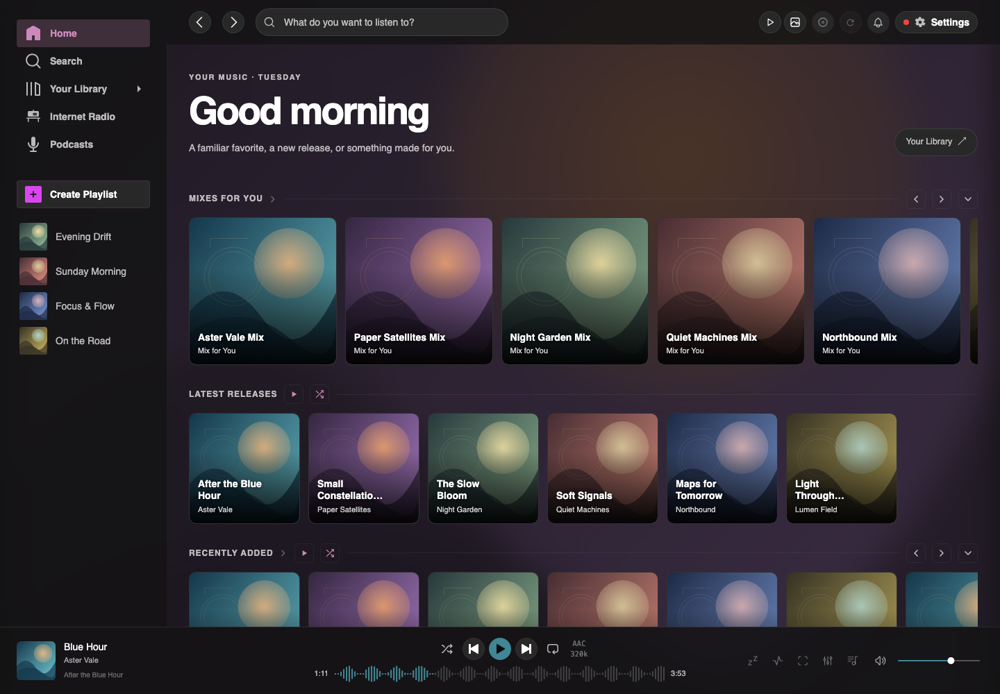
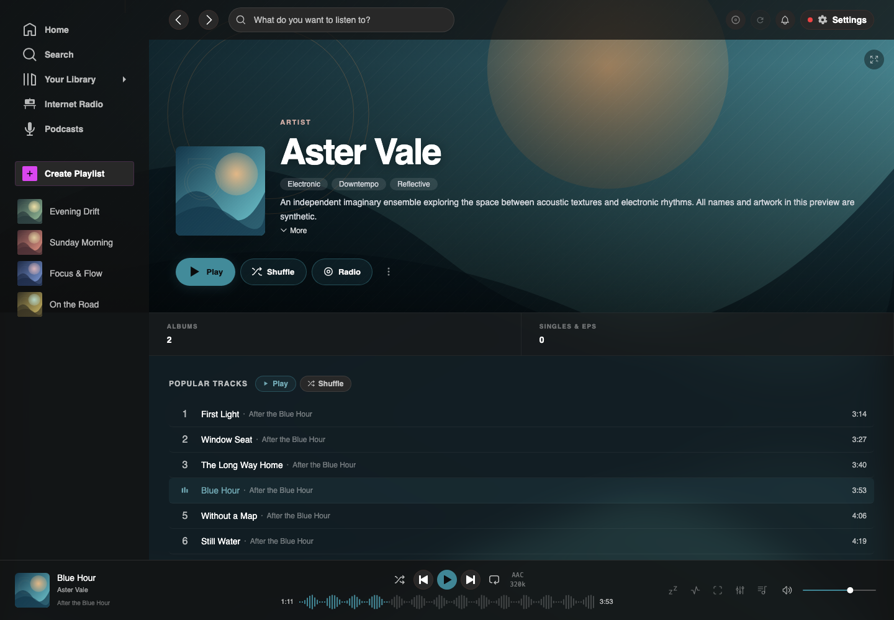
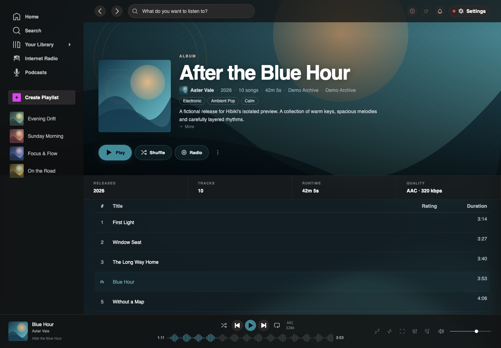
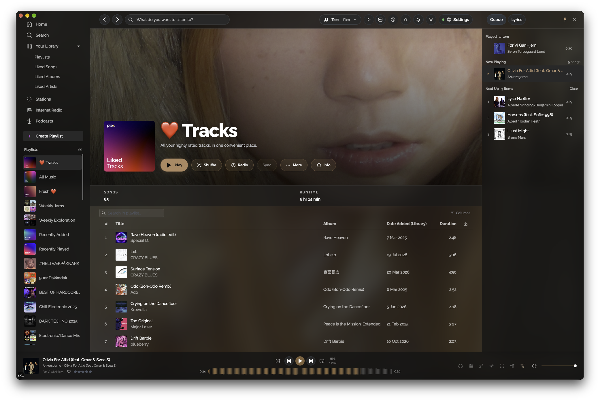
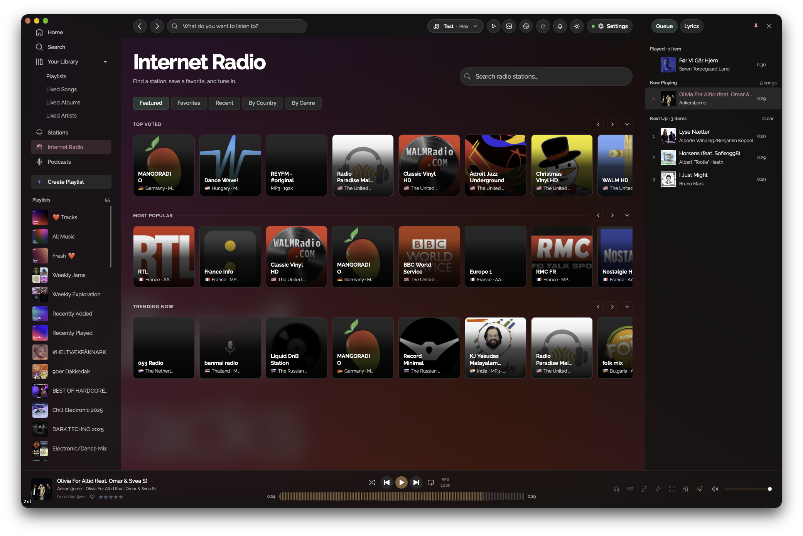
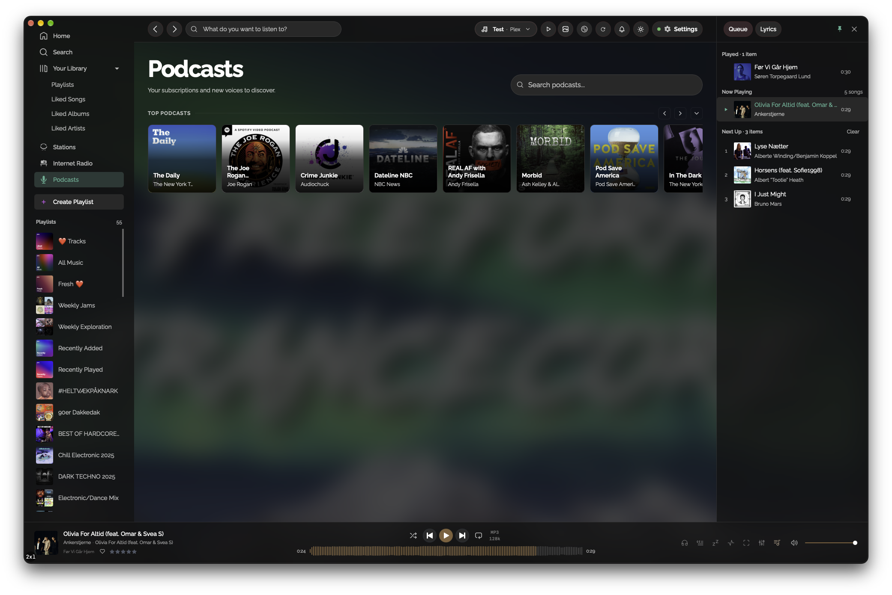
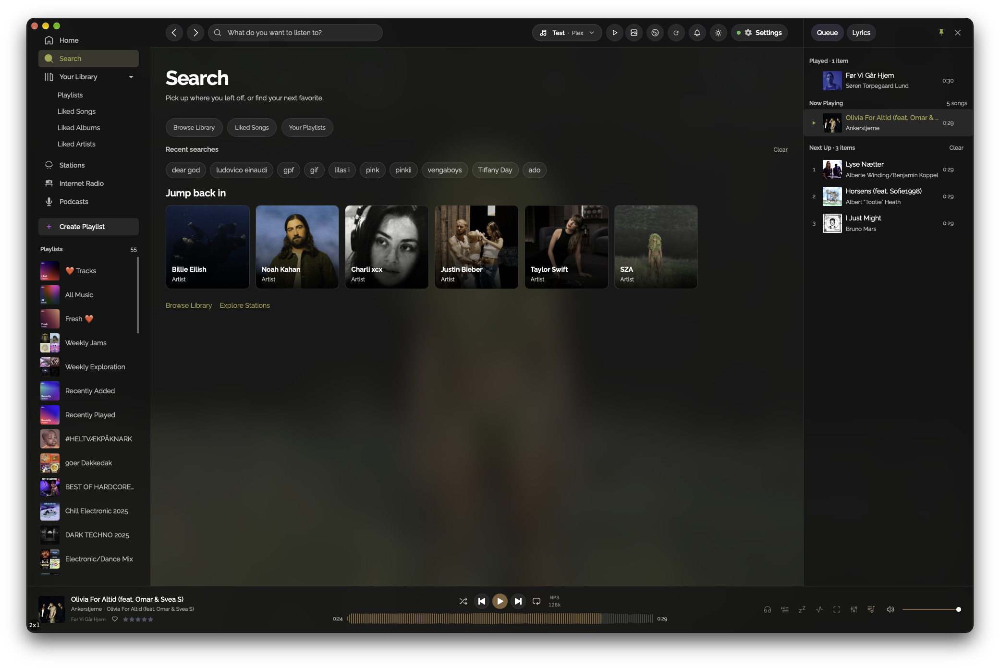

# Hibiki

<p align="center">
  
</p>

A desktop music player for [Plex](https://www.plex.tv/), built with Tauri, React and a native Rust audio engine. Available for macOS, Windows and Linux.

[Download](https://github.com/karbowiak/hibiki/releases) · [Report an issue](https://github.com/karbowiak/hibiki/issues)



## Features

- Gapless playback, crossfade, loudness normalization and a 10-band equalizer.
- Artists, albums, playlists and liked music, with search, large-list browsing and a queue that remembers where you left off.
- Offline downloads for songs, albums, artists and playlists, organized in your Music folder with M3U playlists and automatic checks for new songs.
- Plex stations, track and artist radio, DJ modes, internet radio and podcasts.
- Synced lyrics, waveform seeking and fullscreen visualizers, including MilkDrop.
- Local liked songs, optional Last.fm and ListenBrainz scrobbling and likes sync, and playlist sync with ListenBrainz.
- Metadata enrichment, separate poster/background artwork and reviewed metadata edits in Plex.
- Artwork-based colors, light and dark themes, media keys and keyboard shortcuts.

## Screenshots

These show the current development build; the latest published release may look different.

<p>
  <a href="screenshots/artist.png"></a>
  <a href="screenshots/album.png"></a>
  <a href="screenshots/playlist.png"></a>
</p>
<p>
  <a href="screenshots/internetradio.png"></a>
  <a href="screenshots/podcasts.png"></a>
  <a href="screenshots/search.png"></a>
</p>

## Install

Get the appropriate package from [Releases](https://github.com/karbowiak/hibiki/releases):

| Platform | Package |
| --- | --- |
| macOS | `.dmg` for Apple Silicon or Intel; drag Hibiki into Applications |
| Windows | `.exe` installer |
| Linux | `.AppImage`, `.deb` or `.rpm` |

For an AppImage, make it executable before launching:

```sh
chmod +x Hibiki_*.AppImage
./Hibiki_*.AppImage
```

The app is not currently Apple-notarized or Windows code-signed. On macOS, if Gatekeeper blocks the installed app, remove its quarantine flag:

```sh
xattr -cr /Applications/Hibiki.app
```

On Windows, SmartScreen may require **More info → Run anyway**.

You need access to a Plex Media Server with a music library. Sign in with Plex on first launch, or configure a server URL and token in Settings. Optional metadata and sync services can be configured there too.

## Build and test

Requires [Bun](https://bun.sh/), Rust 1.90 or newer and the [Tauri platform prerequisites](https://v2.tauri.app/start/prerequisites/). The renderer uses Tailwind 4 and needs a current system WebView with [Safari 16.4+ or Chromium 111+ CSS support](https://tailwindcss.com/docs/compatibility).

```sh
git clone https://github.com/karbowiak/hibiki.git
cd hibiki
bun install --frozen-lockfile
bun run tauri dev
```

Use `bun run tauri build` for a production bundle. Podcast Index categories and extended search require `PI_KEY` and `PI_SECRET` in `.env` or the build environment. Debug builds work without them; production builds require both variables to be defined, with empty values disabling that integration.

```sh
bun run build          # TypeScript checks and frontend build
bun run test:frontend  # Frontend regression tests
bun run test:unit      # Rust tests without a Plex server
```

`bun run test` includes live Plex integration tests that can modify server playlists and playback history; it requires a dedicated test server.

For details, see [metadata providers and editing](src/metadata/README.md), [liked songs](src/favorites/README.md), [playlist sync](src/playlistSync/README.md) and [offline storage](src/offline/README.md).

## Credits and license

The original layout was based on [tauri-spotify-clone](https://github.com/agmmnn/tauri-spotify-clone) by [agmmnn](https://github.com/agmmnn). Visualizations use [butterchurn](https://github.com/jberg/butterchurn).

[MIT](LICENSE) · Michael Karbowiak
